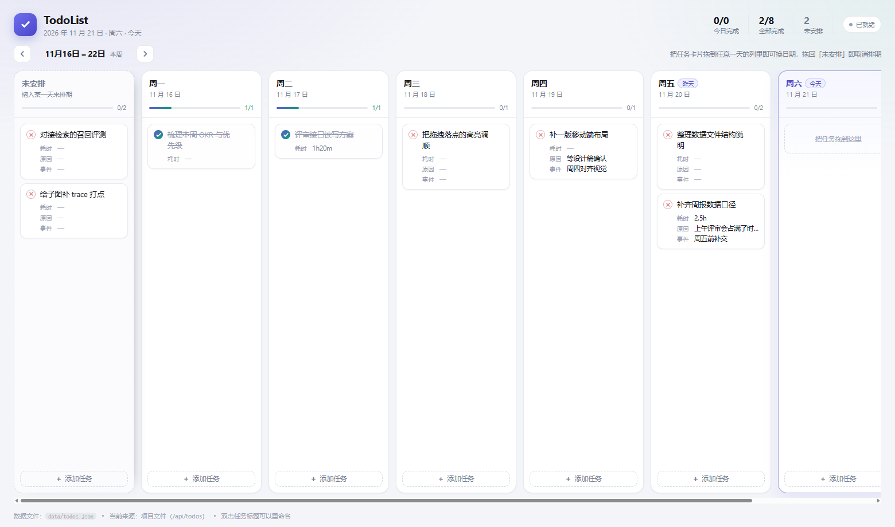

# TodoList · 每周待办

React + Vite 写的周视图待办面板：每天一列，显示日期、完成进度，支持把任务卡片**拖到任意一天**重新排期。数据不放在浏览器里，而是**直接读写项目目录中的 `data/todos.json`**。



## 运行

```bash
npm install      # 已装好可跳过
npm run dev      # http://localhost:5173
```

打包预览（同样能读写数据文件）：

```bash
npm run build
npm run preview  # http://localhost:4173
```

## 数据存储

数据文件：**`data/todos.json`**

浏览器不能直接写本地文件，所以用 Vite 插件在开发/预览服务器上挂了一个极小的接口（`vite.config.js` 里的 `todosFileApiPlugin`）：

| 方法 | 路径 | 作用 |
| --- | --- | --- |
| `GET` | `/api/todos` | 返回 `data/todos.json` 内容 |
| `PUT` | `/api/todos` | 用请求体覆盖写入 `data/todos.json`，并带上 `updatedAt` |

前端每次改动（勾选、新增、拖动、删除、重命名）都会在 320ms 抖动后整表写回文件，右上角状态灯会显示「保存中… / 已写入 data/todos.json」。

数据结构：

```json
{
  "version": 1,
  "updatedAt": "2026-11-17T08:53:31.018Z",
  "todos": [
    {
      "id": "seed-1",
      "title": "梳理本周 OKR 与优先级",
      "date": "2026-11-17",   // null = 未安排（左侧收集箱）
      "done": false,
      "cost": "1.5h",          // 耗时（完成/未完成都有）
      "reason": "",            // 未完成原因（仅未完成卡片显示）
      "event": "",             // 关联事件 / 后续安排（仅未完成卡片显示）
      "order": 0,             // 同一列内的排序
      "createdAt": "2026-11-17T08:00:00.000Z"
    }
  ]
}
```

> 直接用 `file://` 打开 `dist/index.html`（没有服务器）时，接口不可用，会自动退回 `localStorage`，页面底部会标明「浏览器 localStorage」。

## 功能与交互

- **每日日期**：周一至周日各一列，列头显示星期、`M 月 D 日`，以及「昨天 / 今天 / 明天 / 后天」标记；今天那列有高亮底色。
- **完成状态**：未完成卡片左侧是**红色叉叉**，完成后变成实心勾（蓝绿渐变），文字加删除线、卡片置灰；每列底部有 `已完成/总数` 进度条。
- **原因 / 事件 / 耗时**：卡片下方是**双击才可编辑**的字段区 —— 「耗时」无论完成与否都能填（如 `1.5h`、`40 分钟`），「原因」「事件」只在未完成卡片上出现。折叠态只显示文字（空值显示 `—`，过长省略、悬停看全文），双击进入编辑、回车或点卡片外面收起，改动即时写进数据文件。
- **拖拽排期**：按住卡片拖到任意一天的列里即改日期；拖进列内不同位置可调整顺序（拖动时有插入位置指示线和目标列高亮）；拖回「未安排」列即取消排期。
- **新增 / 重命名 / 删除**：列底「＋ 添加任务」回车保存、Esc 取消；双击标题改文字；双击卡片下方字段区改耗时/原因/事件；悬停卡片右侧出现删除按钮。
- **周切换**：← / → 翻上一周/下一周，「回到本周」一键跳回；若有任务落在别的周，顶部会提示「另有 N 项在其他周」。
- **未安排收集箱**：横向滚动时固定在左侧（sticky），方便随时把任务拖到当前可见的某一天。
- 跟随系统深浅色（`prefers-color-scheme`），窄屏自动切为可横向滑动 + scroll-snap 的单列浏览。

## 目录结构

```
TodoList-Front/
├─ data/todos.json          # 数据文件（唯一数据源）
├─ index.html
├─ vite.config.js           # React 插件 + data/todos.json 读写中间件
└─ src/
   ├─ main.jsx
   ├─ App.jsx               # 状态、周视图、增删改移逻辑
   ├─ styles.css
   ├─ components/
   │  ├─ DayColumn.jsx      # 一列（含拖拽落点计算、内联添加）
   │  └─ TodoItem.jsx       # 任务卡片（勾选、双击重命名、拖拽源）
   └─ lib/
      ├─ date.js            # 本地时区日期工具（周一为周起点）
      └─ store.js           # /api/todos 读写 + localStorage 兜底
```

## 说明

- `data/todos.json` 里预置了几条示例任务（日期落在 2026-11-16 ~ 11-22 这一周），可以直接改成你自己的数据，或全部删掉重新添加。
- 日期一律按**本地时区**格式化为 `YYYY-MM-DD`，避免 `toISOString()` 的 UTC 偏移把深夜任务算到前一天。
